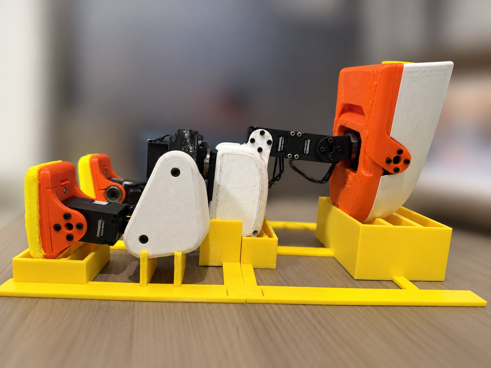
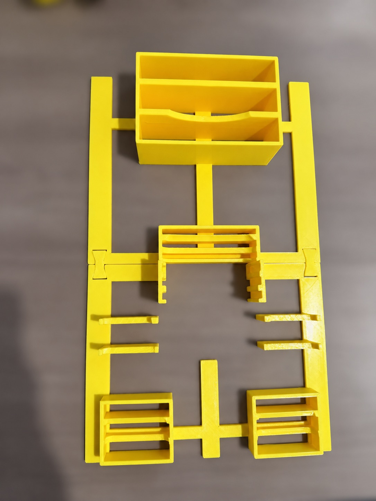
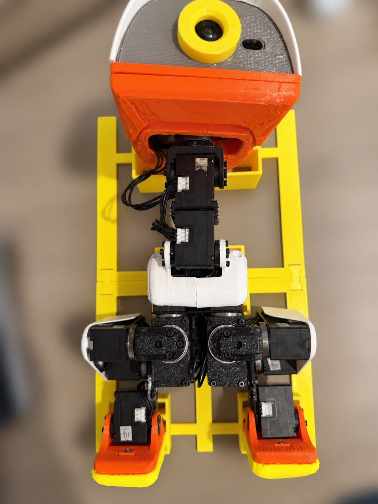
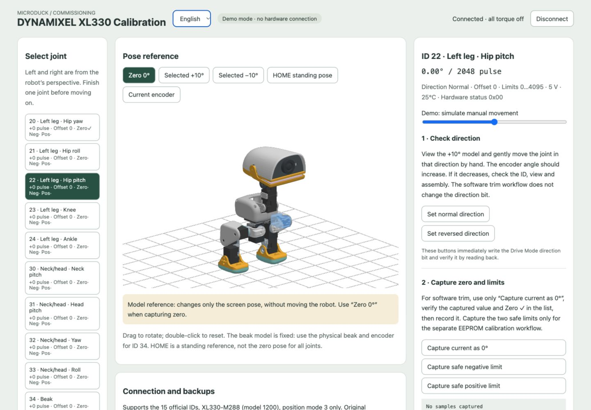
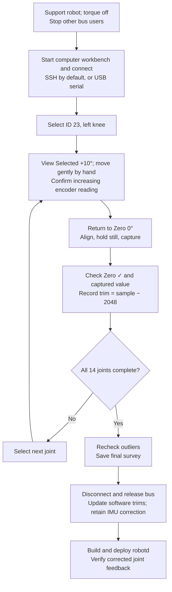

# microduck-tools

[简体中文](README.md) | **English**

Microduck calibration workbench and final V3 calibration tray. **The workbench always runs on your computer. It uses the Microduck controller’s servo port over SSH by default, or a USB serial adapter connected directly to your computer.**

The calibration workbench, including its 3D renderer, lives in `tools/xl330-calibration/`, models in `assets/models/`, printing files in `CAD/`, and controller adaptation patches in `patches/`. `work/` holds locally generated parameter backups and zero-position surveys.

## Contents

- [Photos](#photos)
- [Calibration workbench](#workbench)
- [Connection and installation](#connection)
- [Default: SSH connection](#ssh-connection)
- [Direct USB serial connection](#usb-connection)
- [Calibration workflow](#calibration-flow)
- [Applying calibration results](#apply-calibration)
- [Connection troubleshooting](#connection-issues)
- [Offline tests](#offline-tests)
- [V3 tray printing](#cad-printing)
- [Sources and licenses](#licenses)

<a id="photos"></a>

## Photos

Place the robot on its back in the tray. The head, torso and feet each have a support area.



| Tray, top view | Robot placement, top view |
| --- | --- |
|  |  |

Photo backgrounds were blurred with AI assistance to hide unrelated details. These photos show assembly and placement; check each joint’s zero pose against the workbench model.

<a id="workbench"></a>

## Calibration workbench



English workbench screenshot (demo mode, 1440 × 1000 desktop browser viewport).

The interaction takes inspiration from kissqy/Microduck-kissqy: individual joint selection, separate zero / positive / negative / HOME references, capture, preview and save. The DYNAMIXEL Protocol 2.0 backend was implemented independently; no source code, calibration data or UI assets were copied from that project. The 3D renderer `tools/xl330-calibration/duck-view.js` keeps only what calibration preview needs and reuses the existing model; see the [upstream model license statement](https://github.com/pollen-robotics/microduck_rl/blob/d424a0c899f6b33cbd3daeb279913134349c0b63/README.md#license).

Supports this project’s **15 XL330-M288-T servos (model 1200), position mode 3**. The only EEPROM writes are the Drive Mode direction bit, Homing Offset and Min/Max Position Limit. The workbench never sends Goal Position, enables torque, stops services automatically or modifies IMU calibration.

Use the header’s **中文 / English** selector to switch languages without reconnecting or clearing samples. Your preference is saved in this browser; on first use, the browser language selects Chinese or English. Labels, live telemetry, capture/preview text, accessibility labels and application error messages follow the selected language. External system/SDK diagnostic details remain as returned by their source.

Selecting a servo highlights its actual housing in blue. Hidden surfaces appear through the shell in translucent blue. Drag to rotate and double-click to reset. The beak geometry is fixed; HOME is a standing reference, not every joint’s zero pose.

For an offline demo:

```bash
./start-calibration.sh --demo
```

Open [the local workbench](http://127.0.0.1:18092/). The demo uses simulated registers and does not connect to hardware.

<a id="connection"></a>

## Connection and installation

**The webpage, calibration logic and parameter backups all stay on your computer.** Choose one transport:

| Transport | Communication path | Command on your computer |
| --- | --- | --- |
| **SSH (default)** | Workbench → SSH `microduck` → controller `/dev/ttyS2` → servo bus | `./start-calibration.sh` |
| Direct serial | Workbench → computer USB serial adapter → servo bus | `./start-calibration.sh --serial YOUR_LOCAL_PORT` |

Both default to **1000000 baud** and this project’s **Microduck 2S profile (6.6–8.2 V)**. About 7.9–8.0 V is normal for this design. Voltage and error indicators remain visible; Shutdown and voltage limits are never changed.

On macOS / Linux, run once in this repository on your computer:

```bash
python3 -m venv .venv
.venv/bin/python -m pip install -r requirements.txt
```

<a id="ssh-connection"></a>

## Default: connect from your computer over SSH

Do not deploy the workbench or a web server on the controller. No SSH web-port forwarding is needed. A temporary serial helper runs in controller memory over SSH standard input/output, then exits and releases the port on disconnection.

### 1. Prepare the robot

Support the robot in the tray and ensure all servos have torque off. Your computer and controller must have network connectivity. Leave the servo bus connected to controller port `/dev/ttyS2`; no USB serial connection to your computer is needed.

### 2. Check SSH login and serial ownership

Configure your computer’s `~/.ssh/config`, replacing the host and username as appropriate:

```sshconfig
Host microduck
    HostName YOUR_ROBOT_HOST
    User microduck
```

Reuse an existing alias, key or SSH agent. You can also select another target with `--ssh user@host`. Never store passwords in the repository.

On your computer:

```bash
ssh microduck
```

On the controller, inspect bus programs and port ownership:

```bash
pgrep -af 'robotd|observer|server.py'
fuser -v /dev/ttyS2
```

Stop any controller, old calibration or observer program using its normal procedure, then check that the port was released. The workbench does not stop programs or turn torque off for you. If permissions prevent inspection, use an authorized account; empty output alone does not prove the port is free.

Return to your computer and verify non-interactive login:

```bash
exit
ssh -o BatchMode=yes microduck true
```

This must finish without a password prompt. Resolve authentication and host-key confirmation before starting the workbench.

The controller needs Python 3.9+ and serial dependencies. For initial setup, log in with `ssh microduck` and install only these dependencies on the controller:

```bash
python3 -m pip install --target "$HOME/.local/share/microduck-serial/deps" \
  dynamixel-sdk==4.0.5 pyserial==3.5
exit
```

If pip is missing, install it through the controller’s package manager first. The helper searches `~/.local/share/microduck-serial/deps`, the legacy `~/diagnostics/readlibs`, then the interpreter’s normal module paths.

To choose a different remote interpreter or dependency location, run on your computer:

```bash
./start-calibration.sh --ssh microduck --remote-python /usr/bin/python3 \
  --remote-pythonpath '~/.local/share/microduck-serial/deps'
```

`--remote-python` accepts a remote executable name or absolute path. Repeat `--remote-pythonpath` for multiple directories; specifying it replaces the default extra paths. `~` expands under the controller account. Connecting does not install dependencies or change controller permissions.

### 3. Start on your computer

From this repository:

```bash
./start-calibration.sh
```

Equivalent defaults:

```bash
./start-calibration.sh --ssh microduck --remote-serial /dev/ttyS2 --baud 1000000 --microduck-2s
```

Leave the terminal running. Starting the web server alone does not open the remote serial connection.

### 4. Connect in your computer’s browser

Open [the workbench](http://127.0.0.1:18092/), select **English**, check the SSH transport shown, confirm the preparation checkbox and click **Check and connect**.

The temporary helper opens `/dev/ttyS2` exclusively and checks all 15 servos. Original parameters are saved under **this repository on your computer**, in `work/xl330-calibration-backups/`.

When finished, click **Disconnect** so the remote helper exits. Press `Ctrl+C` in the computer’s terminal to stop the web server, then resume the controller using its normal procedure.

<a id="usb-connection"></a>

## Direct USB serial connection

This transport requires a DYNAMIXEL TTL half-duplex adapter. Plugging the controller’s ordinary USB port into your computer does not automatically expose the servo bus.

1. Support the robot and ensure torque is off. With power off, connect the bus and common ground according to the adapter instructions. Restore the robot’s existing 2S supply. Use the adapter for communication and avoid supplying the robot twice.
2. Stop all other bus users, including the controller.
3. On your computer, identify the adapter by unplugging/replugging it:

```bash
.venv/bin/python -m serial.tools.list_ports -v
```

macOS commonly uses `/dev/cu.usbserial-…` or `/dev/cu.usbmodem…`; Linux commonly uses `/dev/ttyUSB0` or `/dev/ttyACM0`. Use the port detected **on your computer**, not controller port `/dev/ttyS2`.

For example, on macOS, replace the placeholder and inspect ownership:

```bash
SERIAL_PORT=/dev/cu.usbserial-YOUR_DEVICE
lsof "$SERIAL_PORT"
```

Close any program using the port normally, then start:

```bash
./start-calibration.sh --serial "$SERIAL_PORT"
```

`--serial` selects direct connection without SSH. Resolve local serial permissions if necessary. Open [the workbench](http://127.0.0.1:18092/), confirm the local serial transport, check the preparation box and click **Check and connect**. Backups remain in your computer’s `work/xl330-calibration-backups/`. Finish with **Disconnect**, then `Ctrl+C`.

<a id="connection-issues"></a>

## Connection troubleshooting

- Port 18092 occupied: inspect `lsof -nP -iTCP:18092 -sTCP:LISTEN`. Reuse an existing computer workbench after checking its transport, or close an old SSH web-forwarding tunnel before starting locally.
- SSH failure: first verify `ssh -o BatchMode=yes microduck true`, then inspect controller permissions, port ownership and Python serial dependencies.
- Servo checks fail: resolve the reported model, mode, torque, temperature, bus or supply issue, then reconnect.
- SSH/serial interruption: the session stops; writes are never retried automatically. An interrupted save may have partially changed parameters. Reconnect and compare against the backup from before the failure.

<a id="calibration-flow"></a>

## Calibration workflow: capture each zero, then apply software trim



If direction or capture checks fail, resolve the issue and repeat that joint. ID 34 is recorded only as a beak-closed note, with software trim kept at 0. **This workflow does not write servo EEPROM.** Disconnect the workbench before updating or restarting the controller.

Start with the left knee, then measure the left leg, right leg and neck/head. **Do not click Set normal/reversed direction, capture the two safe limits, or click Write selected joint and verify for this software trim workflow.** Direction and limits have separate mechanical requirements.

### 1. Verify the baseline after connection

Check that all 15 servos are online with torque off and a pre-connection backup exists on your computer. The **Offset** reading must be **−512 for knees ID 13 and 23**, and **0 for all other joints** for the runtime described below. Record the current Drive Mode; check direction using the model rather than overwriting it.

Support neighboring links as needed. Never force a joint blocked by the tray, desk or straps. Support the head while checking neck axes.

**An arbitrary resting position with torque off is not a calibration error. Align the robot to the model’s zero pose before sampling.** Left/right always refer to the robot. Compare links relative to the torso, including when the robot is on its back.

### 2. Complete ID 23, left knee, first

1. Select **23 · Left leg · Knee**. Confirm the right-hand title shows ID 23 and live readings, for example `−0.35° / 2044 pulse`.
2. Select **Zero 0°** and rotate the model to a side view. Match the real knee’s straight pose and support it. Neither HOME nor Current encoder is the zero reference.
3. Select **Selected +10°**. Observe the model’s bending direction, then gently move the real lower leg in that direction. The displayed angle should **increase**; exact 10° movement is unnecessary.
4. If it decreases, check ID, view and assembly before continuing. Do not use the direction buttons. If it does not change, check the selected joint and connection.
5. Return to **Zero 0°**, straighten and hold the knee still, then click **Capture current as 0°**.
6. Verify `Zero: N pulse` in the capture box, `Zero✓` beside ID 23, and no error. Capture requires ten readings spanning no more than 8 pulse. Stabilize and retry if movement is reported.
7. **Record N from the capture box, not the large live reading after letting go.** A sample of 2051 means `2051 − 2048 = +3 pulse`, about `+0.26°`. This is an example, not a target value.

The live reading need not show 0° after capture: the software correction has not been applied yet.

### 3. Repeat for the remaining joints

For each joint: **select ID → inspect Zero 0° → check increasing direction with Selected +10° → return to zero and hold → capture → verify the captured value and Zero✓ → record**.

| Order | ID / joint | View | Zero-pose check |
| --- | --- | --- | --- |
| 1 | 23 left knee | Side | Upper and lower leg straight, as in the model |
| 2 | 20 left hip yaw | Top | Toes face forward relative to torso |
| 3 | 21 left hip roll | Front | Leg’s inward/outward angle relative to torso |
| 4 | 22 left hip pitch | Side | Thigh’s forward/backward angle |
| 5 | 24 left ankle | Side | Foot-to-lower-leg angle |
| 6 | 13 right knee | Side | Same straight reference as left knee |
| 7 | 10 right hip yaw | Top | Toes forward; compare feet for parallel alignment |
| 8 | 11 right hip roll | Front | Right leg’s inward/outward angle |
| 9 | 12 right hip pitch | Side | Thigh angle; cross-check with left side |
| 10 | 14 right ankle | Side | Foot-to-lower-leg angle |
| 11 | 30 neck pitch | Side | Support head; compare neck-to-torso angle |
| 12 | 31 head pitch | Side | Keep neck reference; compare head tilt up/down |
| 13 | 32 head yaw | Top | Beak points straight forward relative to torso |
| 14 | 33 head roll | Front | Head upright without sideways tilt |

Use the model for all views and references. Only the selected joint changes in the ±10° reference; try to move just that axis while supporting the others.

**ID 34, beak:** the model has no usable moving zero reference for this workflow. Gently close the beak and record its encoder reading as a note. Do not squeeze, capture zero or treat `closed reading − 2048` as a trim. Keep ID 34 software trim at 0.

### 4. Preserve readings and records

| List display | Meaning |
| --- | --- |
| `±N pulse` | Live position minus 2048; may change when released; not the captured trim |
| `Offset N` | EEPROM Homing Offset, not software trim |
| `Zero✓` | Zero captured during this session |
| `Neg· Pos·` | Limits not captured; expected for this workflow |
| `Written` or completion check | EEPROM was written; not this workflow’s completion criterion |

Record **ID, increasing direction confirmed, captured zero, error in pulse, notes** for each joint. Convert error to degrees with `error × 360 / 4096`; 1° is about 11.38 pulse.

Draft captures are not automatically saved to disk, and the connection backup does not contain later captures. While still connected, open another terminal **in this repository on your computer**:

```bash
mkdir -p work/zero-surveys
curl --fail --silent --show-error http://127.0.0.1:18092/api/state \
  -o "work/zero-surveys/zero-survey-$(date +%Y%m%d-%H%M%S).json"
```

Check that `joints[].marks.zero` exists for all 14 non-beak joints. ID 34 should be empty. Save before disconnecting or reconnecting; reconnecting clears captures. This file stays on your computer for either transport.

### 5. Recheck outliers

Recheck deviations above about 3° and inconsistent placements. Move away from zero, realign using the same model view and torso reference, then capture again. Manual alignment repeatability may be around ±1.5°; one or two pulse do not imply equivalent mechanical precision.

**Clicking capture does not prove success.** For example, if ID 12 was captured at 1990 and later live readings show 2006, the capture box must actually update to 2006 before recording **−42 pulse**, rather than the old −58. If ID 33 remains reliably at 1994 on recheck, retain **−54 pulse**. These are examples, not values to copy.

Check for errors and confirm the box holds the new capture. If it matches the old number, cross-check the live reading while held steady; unchanged text alone proves neither success nor failure. Save the final records and state file after rechecks.

### 6. Finish sampling

Completion means all 14 non-beak joints have direction checks and final zero records, outliers were rechecked, ID 34 has a separate note, and files were saved on your computer. Limit checkmarks and EEPROM writes are unnecessary.

Calculate and verify the software trim array below. Then disconnect and stop the workbench to release the bus before updating the controller. Capturing measurements and applying them to the running binary are separate steps.

<a id="apply-calibration"></a>

## Applying calibration results

This section targets Pollen Robotics `microduck` **daemon-v0.17.8**, baseline commit `942e58e3aa6dbb28e7037203fff11866122c7567`. The included [software zero-trim and IMU patch](patches/robotd-v0.17.8-gyro-zero-trim.patch) is self-contained and does not depend on another local repository or uncommitted changes.

The runtime uses **software zero trim**, compiled into `robotd`, to correct bus feedback and targets. The workbench’s automatic JSON backup contains original registers; it is not a calibration configuration automatically loaded by the runtime.

### 1. Distinguish software trim from EEPROM writes

| Item | Behavior | Application |
| --- | --- | --- |
| Capture zero | Records Present Position without writing EEPROM | Convert to `ZERO_TRIM_COUNTS` and update runtime |
| Write button | Writes Homing Offset and position limits; direction buttons immediately write Drive Mode | Separate EEPROM calibration path |
| `robotd` startup | `check_registers_of()` enforces Homing Offset −512 for ID 13/23, 0 otherwise | Other workbench offsets will not reliably persist at runtime |
| Direction and limits | The patch does not import these into software trim or reset them all at startup | Check separately against actual mechanics |

Keep the runtime’s required Homing Offset baseline and apply measured errors in software. Do not compensate for the same error in both EEPROM and the software array. Copying backup JSON onto the controller does not apply trim.

### 2. Calculate trims from final samples

With other bus users stopped and torque off, verify offsets: knees ID 13/23 at −512, others at 0. If incorrect, verify and restore this robot’s correct baseline, never another robot’s backup. Use the final captured value or saved `joints[].marks.zero`, not live position after releasing the joint.

At that baseline:

```text
ZERO_TRIM_COUNTS[joint] = captured zero Present Position − 2048
zero_trim (radians) = ZERO_TRIM_COUNTS × 2π / 4096
```

For ID 20 captured at 2023, trim is **−25 counts**. Feedback subtracts that trim; a runtime zero target adds it back so the corresponding servo target count is 2023.

If Homing Offset was already changed, subtraction of 2048 alone is insufficient. Only with unchanged direction, identical physical zero and no wrap can you convert to the runtime baseline:

```text
trim counts = current zero reading − current Homing Offset
              + runtime baseline Homing Offset − 2048
```

Prefer restoring the correct baseline and recapturing. If limits were changed with an offset, verify their coordinates when restoring the offset too.

### 3. Update the runtime array and related corrections

Edit `ZERO_TRIM_COUNTS` in `duck-control/src/model.rs`, following `JOINT_IDS` / `JOINT_NAMES`, **not numeric ID order**:

```text
Array index:  0   1   2   3   4    5   6   7   8   9   10  11  12  13  14
Servo ID:    20  21  22  23  24   30  31  32  33  34   10  11  12  13  14
```

The patch defaults to all **0**. Replace them with this robot’s final measurements, and replace the `zero_trims_are_neutral_by_default` test with checks of your measured values by servo ID.

The following shows format only. **Do not apply these nonzero example values to your robot:**

```rust
pub const ZERO_TRIM_COUNTS: [i32; NUM_JOINTS] = [
    -25, 16, 5, 3, 8,        // Left leg: 20 21 22 23 24
    -3, -6, -3, -54, 0,     // Neck, head, beak: 30 31 32 33 34
    -51, -40, -42, -22, -10, // Right leg: 10 11 12 13 14
];
```

Keep ID 34 at 0; the fixed beak mesh cannot establish its zero. Keep `DEFAULT_POSITION` as the original standing pose; do not alter standing references or policy weights to correct zero.

The patch also corrects **IMU v1.2 angular velocity units** (`count / 16.4` to °/s). Retain the `imu.rs` correction and tests for that protocol. Check units before using another IMU protocol. Joint trim itself does not change the IMU.

Retain all three changes in `duck-control/src/bus.rs`, rather than copying only the array:

- `present_positions()`: subtract `zero_trim(joint)` from initial position readings.
- `RobotIo::read()`: subtract the same trim from periodic feedback.
- `RobotIo::write()`: add the same trim before sending targets.

```text
Feedback q = (Present Position − 2048) × 2π / 4096 − zero_trim
Angle corresponding to target counts = policy target q + zero_trim
```

The workbench’s **Current encoder** view still uses EEPROM readings and does not load Rust software trims. Do not confuse it with corrected runtime feedback.

### 4. Build and deploy robotd

Update the **controller binary**; the web workbench stays on your computer. Editing Rust locally, restarting an old binary or copying backup JSON does not update the running array.

From this project on your computer, obtain the pinned public runtime in a sibling directory:

```bash
TOOLS_ROOT="$PWD"
git clone https://github.com/pollen-robotics/microduck.git ../microduck-runtime
cd ../microduck-runtime
git switch -c calibration-v0.17.8 942e58e3aa6dbb28e7037203fff11866122c7567
git apply --check "$TOOLS_ROOT/patches/robotd-v0.17.8-gyro-zero-trim.patch"
git apply "$TOOLS_ROOT/patches/robotd-v0.17.8-gyro-zero-trim.patch"
```

If the directory exists, verify its upstream and preserve uncommitted work. Do not overwrite it or reapply an already-applied patch. Other baselines need manual adaptation.

Fill in your own measurements and update tests before running in the runtime repository:

```bash
cargo test -p duck-control
```

Follow the pinned upstream [development build and deployment instructions](https://github.com/pollen-robotics/microduck/blob/942e58e3aa6dbb28e7037203fff11866122c7567/docs/robot/dev-push.md) for the robot architecture. Once the board, signing key and cross-compilation toolchain are configured:

```bash
scripts/dev-push.sh microduck
```

This installs build artifacts and restarts related controller services. Disconnect the workbench first. Inspect `systemctl cat robotd` and the actual executable path; confirm the running binary contains the new trims. Custom systemd overrides may still point to an old binary. Preserve robot-specific trims and applicable IMU corrections across future upgrades.

### 5. Verify and roll back

1. Disconnect and stop the workbench before giving `robotd` the bus.
2. Confirm systemd’s executable path and running binary point to the new build. Check logs, health and IMU ready; retain the IMU correction.
3. Without moving the robot, compare old/new feedback: `new feedback − old feedback = −(new trim − old trim) × 2π / 4096`. From an untrimmed version this reduces to `−new trim × 2π / 4096`. Do not subtract an old correction twice. Check all 15 joints, including the zero-trim beak.
4. Keep torque off, align each mechanical zero to the model and check feedback is near zero. Small manual movement in the positive reference direction must increase feedback.
5. Before resuming control, ensure policy targets plus trims stay inside saved EEPROM limits. Software trim does not widen those limits.
6. Resume normal operation only after the original controller’s supported posture checks. The workbench never enables torque or sends motion targets.

For software rollback, restore the previous trim array, rebuild and deploy that controller version. For EEPROM rollback, stop the controller and restore this robot’s backup from before the fault through the workbench. Check runtime version and EEPROM baseline together.

The gyro scaling change in `duck-control/src/imu.rs` is independent of joint zero trim. It is not derived from the zero survey and joint trims are not written into the IMU.

## Appendix: EEPROM calibration and restore

Use this separate path only when deliberately choosing EEPROM calibration and the controller will not overwrite those registers. Basic encoder coordinates are `q = (Present Position − 2048) × 2π / 4096`. The workbench makes the captured zero correspond to 2048:

```text
new Homing Offset = old Homing Offset + 2048 − captured zero
```

Both limits shift by the same offset delta. Position mode supports only ±1024 Homing Offset here; larger corrections require horn reinstallation. No modulo operation hides wraps or installation errors. Limits must remain within 0–4095 and surround 2048, an intentional support restriction. Direction writes preserve other Drive Mode bits; Homing Offset sign does not automatically flip with direction.

Restore the selected joint from this connection’s original parameters or a historical backup. Model and ID cannot uniquely identify a physical servo: confirm the robot and joint yourself. **Keep the backup directory.** Communication/read-back errors disconnect the session; partial writes may already exist. Other joints are not written and success is not reported. Reconnect and choose the backup from before the failure, not a new backup of the partially changed state. Restore writes are verified individually; power loss cannot guarantee automatic rollback.

The server binds only to loopback and requires same-origin writes. One lock serializes bus operations. Port exclusivity and startup silence checks cannot prevent another physical controller joining later; maintain a single bus owner. The 3D renderer is for preview only.

References: [XL330 official control table](https://emanual.robotis.com/docs/en/dxl/x/xl330-m288/), [interaction reference project](https://github.com/kissqy/Microduck-kissqy).

<a id="offline-tests"></a>

## Offline tests

```bash
python3 -m unittest discover -s tools/xl330-calibration -p 'test_*.py' -v
node --test tools/xl330-calibration/test_i18n.cjs
```

Tests use simulated registers and cover zero conversion, direction, limits, failures and backup restoration; they are not hardware acceptance tests. Validate each real joint with your wiring and firmware.

## Microduck official 2S supply

Hardware startup defaults to `--microduck-2s`. It requires **6.6–8.2 V**, permits the input-voltage error bit **0x01**, and keeps that error visible. Other hardware errors, torque enabled or temperature at/above **60°C** stop operation. Shutdown and voltage limits are not modified. Only a `SerialBus` without this profile uses the XL330 3.7–6.0 V check; this project’s hardware entry point enables 2S by default.

Source: [Microduck official design §3.2](https://github.com/pollen-robotics/microduck/blob/main/docs/design/robotd-design.md#32-state-out).

<a id="cad-printing"></a>

## V3 calibration tray printing

Final STEP/STL files in `CAD/`, units **mm**:

| Part | STEP | STL | Quantity |
| --- | --- | --- | ---: |
| Original upper half | [head.step](CAD/head.step) | [head.stl](CAD/head.stl) | 1 |
| Lower half with NP-F550 clearance correction | [legs_npf550_r1.step](CAD/legs_npf550_r1.step) | [legs_npf550_r1.stl](CAD/legs_npf550_r1.stl) | 1 |
| Butterfly joining key | [key.step](CAD/key.step) | [key.stl](CAD/key.stl) | 2 |

If you already have the upper half and keys, print only the corrected lower half. Place flat bottoms down at 100% scale. Select your printer, 0.4 mm nozzle and PETG, using Bambu’s default **0.20 mm Standard** process.

Place the robot on its back and hold it gently with soft hook-and-loop straps, avoiding the battery, clips and cables. Remove the robot before motion tests. Clearance was checked for the official standard NP-F550 shape; 25–26 mm thick batteries are not guaranteed to fit. Test the nominal 0.4 mm clearance physically. The tray is not a precision angle gauge.

### Bambu CLI material and time estimates

The final STL files were sliced on **2026-10-27 with Bambu Studio 02.08.02.61 CLI**. These are slicer estimates, not measured print times.

Configuration: **Bambu Lab P1S, 0.4 mm nozzle, Bambu PETG Basic**, default **0.20 mm Standard**, without custom wall or process overrides. Effective settings: 2 walls, 15% grid infill, 5 top layers, 3 bottom layers, supports off, automatic brim, textured PEI plate. Parts were flat-bottom down, 100% scale and automatically centered. Plate 1 holds the upper half and two keys; plate 2 holds the corrected lower half. Filament density follows the official profile at 1.25 g/cm³.

| Plate | Parts | Filament | Model printing time | Total estimated time with startup |
| --- | --- | ---: | ---: | ---: |
| 1 | `head` ×1 + `key` ×2 | 78.30 g | 2 h 10 min 22 s | 2 h 16 min 37 s |
| 2 | `legs_npf550_r1` ×1 | 46.20 g | 1 h 38 min 4 s | 1 h 44 min 18 s |
| **Complete set, two plates** | **4 parts** | **124.50 g** | **3 h 48 min 26 s** | **4 h 0 min 55 s** |

**If you have the upper half and keys, print only the corrected lower half: 46.20 g, approximately 1 h 44 min.** Allow at least 55 g for that part, or 140 g for the full set, including purge and minor losses.

Values come directly from CLI G-code headers: `model printing time`, `total estimated time`, `total filament weight [g]`. Total time includes estimated startup but excludes removal, cooling and manual plate changes. Filament profile, printer, speed mode and plate layout affect results. Slicing reported no warnings; G-code passed basic static checks, with generic-validator notes for Bambu-specific commands and relative motion. Slicing was local only; no print job was sent.

<a id="licenses"></a>

## Sources and licenses

**Original software in this repository is licensed under [Apache-2.0](LICENSE)**, including original code in `tools/`, launcher scripts and tests. Patches to Apache-2.0 upstream software are provided under Apache-2.0 with attribution retained. This software license does not cover robot geometry, CAD / STL / STEP, photos or third-party dependencies.

| Content | Source and terms |
| --- | --- |
| Robot reference geometry, UI robot model and derived fixtures | Pollen Robotics [`microduck_rl`](https://github.com/pollen-robotics/microduck_rl/tree/d424a0c899f6b33cbd3daeb279913134349c0b63), commit `d424a0c899f6b33cbd3daeb279913134349c0b63`. The pinned README says CC BY-SA-NC for model files without a version number; no additional version or commercial permission is implied. See the [pinned upstream README](https://github.com/pollen-robotics/microduck_rl/blob/d424a0c899f6b33cbd3daeb279913134349c0b63/README.md#license) for the original license statement. Software Apache-2.0 does not cover mechanical models. |
| XL330 workbench and 3D renderer | Original software under [Apache-2.0](LICENSE); see [workbench implementation and interaction reference](#workbench). |
| Runtime adaptation patch | Based on the [pinned Pollen Robotics microduck commit](https://github.com/pollen-robotics/microduck/tree/942e58e3aa6dbb28e7037203fff11866122c7567), under Apache-2.0. Trims default to zero; supply your own measurements. |
| Photos | User-provided robot and tray photos for this project’s documentation; code or model licenses do not automatically apply. |
| 3D-printed calibration fixture | The V3 zero tray references Xingmao’s XGO Duck neutral-position tray (`R7_X2D04_PETG_slice_reference.gcode.3mf`, CC BY-NC-SA 4.0), borrowing only the supine positioning approach. This design and derived geometry retain attribution and noncommercial terms under CC BY-NC-SA 4.0, without expanding upstream permissions. See [printing instructions](#cad-printing). |

This is an unofficial personal research reproduction, not an official Pollen Robotics release.
