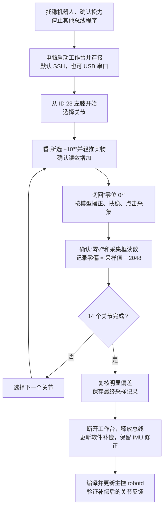

# microduck-tools

**简体中文** | [English](README.en.md)

Microduck 标定工作台与 V3 最终版标定托盘。**工作台始终运行在电脑上，默认通过 SSH 使用 Microduck 的舵机串口，也支持电脑 USB 串口直连。**

工具、模型与打印文件分别位于 `tools/`、`assets/models/` 和 `CAD/`，控制程序适配补丁位于 `patches/`；`work/` 用于本机生成的参数备份与零位采样记录。

## 目录

- [实拍展示](#photos)
- [标定工作台](#workbench)
- [连接方式与首次安装](#connection)
- [默认方式：SSH 连接](#ssh-connection)
- [电脑 USB 串口直连](#usb-connection)
- [标定流程与流程图](#calibration-flow)
- [标定结果如何应用](#apply-calibration)
- [连接问题](#connection-issues)
- [离线验证](#offline-tests)
- [V3 托盘打印说明与耗材时间](#cad-printing)
- [来源与许可](#licenses)

<a id="photos"></a>

## 实拍展示

机器人背部朝下放入标定托盘，头部、躯干和双脚分别由对应区域承托。


| 托盘俯视 | 机器人摆放俯视 |
| --- | --- |
|  |  |

照片背景已使用 AI 辅助虚化，以隐藏无关画面。照片展示托盘装配与摆放方式；各关节零位仍按下文模型参考逐个核对。

<a id="workbench"></a>

## 标定工作台

参考 kissqy/Microduck-kissqy 的逐关节选择、独立零位 / 正负向 / HOME 参考、采集、预览、保存交互，重新实现 DYNAMIXEL Protocol 2.0 后端。未复制对方源码、标定数据或界面资产。复用既有 3D 渲染器及模型（许可见 [官方模型许可记录](LICENSES/官方模型许可依据/README.md)）。

支持本项目的 **15 台 XL330-M288-T（型号 1200）及位置模式 3**。仅写入 EEPROM 的 Drive Mode 方向位、Homing Offset 和 Min/Max Position Limit，不发送 Goal Position、不启用扭矩、不自动停止服务。本工具不会改写 IMU 标定。

工作台顶部可通过 **中文 / English** 切换语言；浏览器会记住选择，首次默认按浏览器语言选择。切换不影响连接、采样或所选关节。界面文案、关节名称、实时读数、操作提示及应用错误支持双语；外部系统及 SDK 返回的诊断细节保留原文。选择舵机时会高亮实际舵机本体，被外壳遮挡的部分以半透明蓝色透视显示。拖动旋转，双击复位。

离线演示：

```bash
./start-calibration.sh --demo
```

打开 [本机工作台](http://127.0.0.1:18092/)，无需连接硬件。

<a id="connection"></a>

## 连接方式

**标定工作台始终运行在电脑上，网页、标定逻辑和参数备份都在电脑上。** 默认通过 SSH 使用 Microduck 主控的舵机串口；也可以通过 USB 舵机串口适配器直接连接电脑。两种方式选一种。

| 方式 | 电脑到舵机的通信路径 | 启动命令（电脑） |
| --- | --- | --- |
| **SSH（默认）** | 电脑工作台 → SSH `microduck` → 主控 `/dev/ttyS2` → 舵机总线 | `./start-calibration.sh` |
| 电脑直连串口 | 电脑工作台 → 电脑 USB 串口 → 舵机总线 | `./start-calibration.sh --serial 电脑上的串口路径` |

两种方式的波特率均默认为 **1000000**，并默认启用本项目的 **Microduck 2S 配置（6.6–8.2 V）**。约 7.9–8.0 V 属于正常范围。工具保留电压和错误显示，不改写 Shutdown 或电压限值。

### 首次准备：在电脑安装依赖

以下命令适用于 macOS / Linux，在电脑上的本仓库根目录执行一次：

```bash
python3 -m venv .venv
.venv/bin/python -m pip install -r requirements.txt
```

<a id="ssh-connection"></a>

## 方式一：电脑工作台通过 SSH 连接 Microduck（默认）

主控无需部署工作台或启动网页服务，也无需 SSH 端口转发。电脑工作台通过现有 SSH 登录临时执行串口读写；临时代码在主控内存中运行，不写入工作台文件，断开后退出并释放串口。

### 1. 准备机器人

将机器人放入标定托盘，确认所有舵机已松力。电脑和 Microduck 主控网络互通，舵机继续接在主控 `/dev/ttyS2` 上，无需接 USB 串口到电脑。

### 2. 检查 SSH 登录和主控串口占用

首次使用需要在电脑的 `~/.ssh/config` 中配置 `microduck` 别名；将 `YOUR_ROBOT_HOST` 替换为主控实际 IP 或主机名，登录用户名按实际系统调整：

```sshconfig
Host microduck
    HostName YOUR_ROBOT_HOST
    User microduck
```

使用你自己的 SSH 密钥或 agent 配置免交互登录。若已有该别名，直接复用；也可启动时通过 `--ssh user@host` 指定其他目标。

**在电脑终端执行：**

```bash
ssh microduck
```

登录主控后，仅检查使用总线的程序和串口拥有者：

```bash
pgrep -af 'robotd|observer|server.py'
fuser -v /dev/ttyS2
```

若主控控制程序、旧标定程序或观察程序占用串口，按对应程序的正常流程停止，再检查串口是否释放。工具不会自动停止其他程序，也不会主动关闭扭矩。权限不足时先用有权限的账户核实，不能把没有输出当作串口空闲。

检查完成后退出主控，回到电脑：

```bash
exit
```

**在电脑验证非交互式 SSH 登录：**

```bash
ssh -o BatchMode=yes microduck true
```

命令应正常退出且无需输入密码。工作台使用现有 SSH 配置、密钥或 SSH agent；若此命令失败，先配置该登录方式及主机指纹确认，再启动工作台。不在仓库中保存密码。

主控需要 Python 3.9+ 和两个串口依赖。首次使用时，通过 `ssh microduck` 登录主控，仅安装串口依赖，不部署网页：

```bash
python3 -m pip install --target "$HOME/.local/share/microduck-serial/deps" \
  dynamixel-sdk==4.0.5 pyserial==3.5
exit
```

若主控没有 pip，先通过主控系统的软件包管理器安装 Python pip。默认依次搜索主控的 `~/.local/share/microduck-serial/deps`、兼容旧部署的 `~/diagnostics/readlibs`，以及该 Python 解释器的标准模块路径。

解释器和依赖目录均可指定。例如，在电脑上使用主控另一处已安装依赖：

```bash
./start-calibration.sh --ssh microduck --remote-python /usr/bin/python3 \
  --remote-pythonpath '~/.local/share/microduck-serial/deps'
```

`--remote-python` 接受主控上的解释器命令或绝对路径；`--remote-pythonpath` 可重复指定，传入后覆盖默认附加目录，`~` 在主控账户下展开。串口权限、SSH 登录及依赖安装是首次准备，不会在点击连接时自动修改主控环境。

### 3. 在电脑启动工作台

**回到电脑本仓库根目录执行：**

```bash
./start-calibration.sh
```

默认等价于：

```bash
./start-calibration.sh --ssh microduck --remote-serial /dev/ttyS2 --baud 1000000 --microduck-2s
```

终端显示本地工作台地址，保持终端运行。此时仅启动电脑上的网页服务，尚未建立 SSH 串口连接。

### 4. 在电脑浏览器连接

打开 [http://127.0.0.1:18092/](http://127.0.0.1:18092/)。确认页面显示 SSH 连接方式，勾选已支撑机器人、全部舵机松力且其他总线程序已停止，然后点击 **检测并连接**。

此时电脑建立 SSH 会话，主控临时串口助手独占打开 `/dev/ttyS2`，检查全部 15 个舵机。检查通过后，原始参数自动备份到**电脑本仓库**的 `work/xl330-calibration-backups/`，随后按下文“标定流程”操作。

结束时先点击网页“断开”，SSH 串口助手随之退出；再在电脑工作台终端按 `Ctrl+C` 退出。最后按原控制系统流程恢复运行。

<a id="usb-connection"></a>

## 方式二：电脑工作台通过 USB 串口直连

此方式不使用 SSH。电脑需要通过兼容 DYNAMIXEL TTL 半双工总线的串口适配器接到舵机总线；仅连接主控的普通 USB 接口不会自动提供舵机串口。

### 1. 连接硬件

将机器人放入标定托盘，确认全部舵机松力。按现有适配器接线说明，在断电状态下接好总线与公共地，再恢复机器人的原 2S 供电。串口适配器用于通信，避免与机器人电源形成重复供电。

停止主控及其他设备对该总线的访问，确保只有电脑工作台使用总线。

### 2. 在电脑识别串口

完成前面的“首次准备”后，**在电脑本仓库根目录执行：**

```bash
.venv/bin/python -m serial.tools.list_ports -v
```

通过插拔适配器确认设备。macOS 通常为 `/dev/cu.usbserial-…` 或 `/dev/cu.usbmodem…`，Linux 通常为 `/dev/ttyUSB0` 或 `/dev/ttyACM0`。这里填写电脑检测出的设备名，不使用主控的 `/dev/ttyS2`。

### 3. 在电脑检查占用并启动

以下以 macOS 为例，将路径替换为实际串口，在同一个电脑终端执行：

```bash
SERIAL_PORT=/dev/cu.usbserial-实际设备名
lsof "$SERIAL_PORT"
```

若有程序占用，先正常退出对应程序；串口空闲后执行：

```bash
./start-calibration.sh --serial "$SERIAL_PORT"
```

指定 `--serial` 即选择电脑直连，不建立 SSH 会话。保持终端运行；若出现权限错误，先处理电脑上的串口访问权限。

### 4. 在电脑浏览器连接

打开 [http://127.0.0.1:18092/](http://127.0.0.1:18092/)，确认页面显示电脑串口连接方式，勾选准备确认项，点击 **检测并连接**。检查通过后按下文“标定流程”操作。

备份同样保存在**电脑本仓库**的 `work/xl330-calibration-backups/`。结束时先点击网页“断开”，再在电脑终端按 `Ctrl+C` 退出工作台。

<a id="connection-issues"></a>

## 连接问题

- 本机 18092 端口已被占用：用 `lsof -nP -iTCP:18092 -sTCP:LISTEN` 检查。若已有电脑工作台，确认连接方式后复用；若是以前留下的 SSH 网页转发，退出旧隧道后再启动本地工作台。
- SSH 连接失败：先在电脑验证 `ssh -o BatchMode=yes microduck true`；再检查主控串口权限、占用及 Python 串口依赖。
- 检测不通过：按页面提示处理型号、模式、扭矩、温度、总线或供电问题，再重新连接。
- SSH 或串口中断：工作台停止会话，不自动重试写入。若中断发生在保存期间，可能已部分写入；重连后先核对参数和故障前备份。

<a id="calibration-flow"></a>

## 标定流程：逐关节采零位，再应用软件补偿



方向不符或采集报错时，先排查并重做当前关节。ID 34 鸭嘴只作闭合读数备注，补偿保持 0；本流程不写舵机 EEPROM。更新与重启控制程序前先断开工作台，确保总线独占。


先从左膝验证操作方法，再依次测量左腿、右腿和头颈，复核后将采样应用到控制程序。工作台全程运行在电脑。

本流程只采零位：**不点“设置正向 / 设置反向”、不采两个安全限位、不点“写入所选关节并校验”。** 方向和限位另有机械装配要求，不能为了让数字接近 0 就改它们。

### 第一步：连接后先确认基准

按前文任一种连接方式点击“检测并连接”，确认页面显示已连接且没有错误：

- 15 个舵机均在线、松力，连接前备份已生成在电脑。
- 右侧“偏移”中，膝关节 ID 13、23 为 **−512**，其余关节为 **0**。
- 标准装配的方向检查以模型和实物为准；先记录 Drive Mode 现状，通过下述 +10° 检查核对方向，不直接覆盖。

机器人应被托稳。检查某关节时，必要时托住相邻连杆，让目标关节不受桌面、托盘或绑带阻挡；不能对着固定住的关节用力扳。头颈检查时要托住头，避免重量带动其他轴。

**松力时随意躺着的读数不是标定误差。必须先把实物摆到模型零位，再看采样值。** 左右均按机器人自身判断；仰卧时也按连杆与躯干的相对姿态对照，不按桌面的上下方向判断。

### 第二步：先完整做一次 ID 23 左膝

一次只做一个动作，完成后再继续：

1. 左侧点 **“23 · 左腿 · 膝盖”**。确认右侧标题变为 ID 23，并看到类似 `−0.35° / 2044 pulse` 的实时读数。
2. 中间点 **“零位 0°”**。拖动模型到侧面，看左膝在零位的姿态；把实物左膝也摆成模型所示的伸直状态，托稳。不要选“HOME 站姿”或“当前编码器”作为零位依据。
3. 点 **“所选 +10°”**，先看清模型小腿往哪边弯。用手轻轻向同一方向移动实物小腿，看右侧角度是否**增加**。不要求精确摆到 10°，只检查变化方向。
4. 如果读数增加，方向检查通过；如果减少，停在此处检查关节 ID、模型视角及装配，不点方向设置按钮。若读数不变，也要先排查是否选错关节或连接已失效。
5. 点回 **“零位 0°”**，把左膝重新摆到伸直，保持静止，点 **“采集当前为 0°”**。
6. 看右侧采集框是否出现 **`零位：N pulse`**，左侧 ID 23 是否出现 **`零✓`**，并确认没有红色报错。采集需十次读数的范围不超过 8 pulse；出现“不静止”提示时，重新扶稳后再采。
7. **记录采集框里的 N，不记录松手后变化的实时大字。** 例如 ID 23 采到 2051，误差为 `2051 − 2048 = +3 pulse`，约 `+0.26°`。该数值只是例子，不是本次必须达到的读数。

这一步完成后，不要求右侧实时角度显示 0°。我们正在量它在机械零位时的读数偏差，尚未应用补偿。

### 第三步：按顺序做其余关节

每个关节都重复相同动作：**选 ID → 对照“零位 0°” → 看“所选 +10°”并轻推核对增加方向 → 回零位扶稳 → 点采集 → 核对“零✓”和采集框 → 记录。**

| 操作顺序 | ID / 关节 | 观察视角 | 零位对照重点 |
| --- | --- | --- | --- |
| 1 | 23 左膝 | 侧面 | 大腿与小腿按零位模型伸直；先完成上面的示范 |
| 2 | 20 左髋转向 | 顶视 | 脚尖相对躯干朝正前方 |
| 3 | 21 左髋侧摆 | 正面 | 对照腿相对躯干是否向外撇或向内收 |
| 4 | 22 左髋前后 | 侧面 | 对照大腿相对躯干的前后角度 |
| 5 | 24 左踝 | 侧面 | 脚底板相对小腿的角度与模型一致 |
| 6 | 13 右膝 | 侧面 | 与左膝同样核对伸直姿态 |
| 7 | 10 右髋转向 | 顶视 | 右脚尖朝前，可与左脚对照是否平行 |
| 8 | 11 右髋侧摆 | 正面 | 对照右腿向外撇或向内收的角度 |
| 9 | 12 右髋前后 | 侧面 | 对照右大腿前后角度，可与左侧交叉核对 |
| 10 | 14 右踝 | 侧面 | 右脚底板相对小腿的角度与模型一致 |
| 11 | 30 颈部俯仰 | 侧面 | 托住头，对照脖子相对躯干的倾角 |
| 12 | 31 头部俯仰 | 侧面 | 保持颈部基准，对照头部低头或抬头角度 |
| 13 | 32 头部转向 | 顶视 | 嘴朝躯干正前方，不向左右偏转 |
| 14 | 33 头部侧摆 | 正面 | 头部端正，不向左右歪斜 |

视角和零位均以页面模型为准。模型上只有选中关节变化；手动检查时也尽量只动这一轴，并托住其他关节。

**ID 34 鸭嘴单独处理：** 模型里的嘴是固定的，没有可用于此流程的运动零位参考。只轻轻合嘴、记录闭合读数作备注，不用力挤、不点零位采集、不把 `闭合读数 − 2048` 当作零偏。本流程的软件补偿中 ID 34 保持 0。

### 第四步：确认读数和记录没有丢

左侧列表的含义：

| 页面显示 | 表示什么 |
| --- | --- |
| `±N pulse` | 当前实时位置减 2048；手一松开就可能变化，不等于已采集误差 |
| `偏移 N` | 舵机 EEPROM 中的 Homing Offset，不是软件补偿 |
| `零✓` | 该关节本次已有零位采样 |
| `负· 正·` | 两个限位未采，本流程属于正常状态 |
| `已写入` 或关节名前的完成勾 | EEPROM 已写入；本流程不以此为完成条件 |

每采一个关节就保存一行记录：**ID、方向是否增加、零位采样值、误差 pulse、备注**。换算为角度时使用 `误差 × 360 / 4096`，1° 约为 11.38 pulse。

页面草稿不是磁盘上的结果文件，连接前备份也不包含之后采集的零位。采集完且仍连接时，可以在**电脑仓库根目录**另开终端保存当前采样状态：

```bash
mkdir -p work/zero-surveys
curl --fail --silent --show-error http://127.0.0.1:18092/api/state \
  -o "work/zero-surveys/zero-survey-$(date +%Y%m%d-%H%M%S).json"
```

成功后检查文件中 14 个非嘴部关节的 `joints[].marks.zero` 均有数值；ID 34 留空是预期行为。保存前不要断开或再次连接，重连会清空本次采样。SSH 与电脑直连方式都在电脑保存此文件。

### 第五步：复核偏差明显或采集可疑的关节

先复核约 3° 以上的偏差，以及两次摆放不一致的关节。离开零位后重新摆正，保持同样的模型视角与躯干基准，再采一次。手摆对照的重复误差可能达到约 ±1.5°，不要把一两 pulse 的差异当作可实现的机械精度。

**按钮点过不代表采集一定成功。** 例如 ID 12 起初记录 1990，复核时实时位置是 2006；确认重新采集成功后，采集框才更新到 2006，最终采用的是 **−42 pulse**，不是旧的 −58。反之 ID 33 复核仍稳定在 1994，保留 **−54 pulse**。

复核时要同时确认没有报错、采集框是这次的结果。若数字碰巧与上次相同，用扶稳时的实时值交叉核对，不能仅凭数字没变判断失败或成功。保存最终复核后的记录与状态文件。

### 第六步：确认完整，再结束采样

完成条件是：**14 个非嘴部关节均已核对方向、有最终零位记录，明显偏差已复核，ID 34 有单独备注，结果文件已保存在电脑。** 两个限位无需出现勾选，也无需点击 EEPROM“写入”。

然后按下文“标定结果如何应用”生成并核对软件补偿数组。确认记录已保存后，点网页“断开”、退出工作台，释放总线，再进入控制程序更新与验证步骤。采样完成和运行时已应用是两件事，后者还必须验证正在运行的新二进制。

<a id="apply-calibration"></a>

## 标定结果如何应用

本节适用于 Pollen Robotics `microduck` 的 **daemon-v0.17.8**，基线提交为 `942e58e3aa6dbb28e7037203fff11866122c7567`。仓库附带 [软件零位及 IMU 适配补丁](patches/robotd-v0.17.8-gyro-zero-trim.patch)，不依赖其他本地仓库或未提交的修改。该控制程序使用**软件零位补偿**：把实测偏差编译进 `robotd`，由总线层统一修正反馈与目标。工作台连接前自动保存的 JSON 是原始参数备份，不是控制程序会自动加载的标定配置。

### 1. 先区分软件补偿与 EEPROM 写入

| 内容 | 当前行为 | 应用方式 |
| --- | --- | --- |
| 零位采样 | 工作台“采集零位”记录当前 Present Position，尚不写 EEPROM | 换算成 `ZERO_TRIM_COUNTS`，更新控制程序 |
| 点击“写入” | 工作台改写 Homing Offset 和位置限位，方向按钮也会立即写 Drive Mode | 这是 EEPROM 路径，与软件补偿不是同一件事 |
| `robotd` 启动 | `check_registers_of()` 将 ID 13、23 的 Homing Offset 校正为 −512，其余 ID 为 0 | 不能依赖工作台写入的其他 Homing Offset 长期生效 |
| 位置限位和方向 | 适配补丁没有把它们导入软件补偿，也没有在启动检查中统一重置它们 | 按实际机械范围和方向单独核对，不能由零位补偿数组代替 |

**使用这份控制程序时，推荐保持它要求的 Homing Offset 基准，采样后更新软件补偿。** 不要把同一偏差同时留在 EEPROM 和软件数组中；也不要把 JSON 备份复制到主控后就认为已应用。

### 2. 在工作台采样并计算补偿值

保持 `robotd` 及其他总线程序停止、舵机松力。先在工作台核对 Homing Offset：膝关节 ID 13、23 应为 −512，其余为 0。已有基准不符合时，先核对并恢复属于本机的正确参数；不要用其他机器人的备份替代。

按上文“标定流程”完成逐关节采样与复核，使用最终采集框中的“零位：N pulse”或电脑保存的状态文件 `joints[].marks.zero` 计算，不使用松手后的实时位置。

在上述 Homing Offset 基准下：

```text
ZERO_TRIM_COUNTS[该关节] = 零位采样 Present Position − 2048
zero_trim（弧度） = ZERO_TRIM_COUNTS × 2π / 4096
```

例如，ID 20 在机械零位时采到 2023，则补偿为 **−25 counts**；读取时原始角度减去 −25 counts 对应的弧度，结果正好是 0。控制程序发出 0° 目标时则加回该补偿，舵机收到的目标计数对应 2023。

若此前已经改写 Homing Offset，不能直接用改写后的读数减 2048。只有确认方向未变、同一实物零位且没有跨圈时，才可换算到运行时基准：

```text
补偿 counts = 当前零位读数 − 当前 Homing Offset + 运行时基准 Homing Offset − 2048
```

更稳妥的流程是先恢复正确的基准参数，再重新摆零位采样。如果已随偏移变化改写位置限位，恢复偏移时也要核对对应限位，不能只改偏移后忽略限位坐标的变化。

### 3. 将结果填入控制程序

修改控制仓库的 `duck-control/src/model.rs` 中 `ZERO_TRIM_COUNTS`。数组必须遵循 `JOINT_IDS` / `JOINT_NAMES` 顺序，**不是按 ID 数字从小到大排序**：

```text
数组索引：  0   1   2   3   4    5   6   7   8   9   10  11  12  13  14
舵机 ID： 20  21  22  23  24   30  31  32  33  34   10  11  12  13  14
```

补丁中 `ZERO_TRIM_COUNTS` 默认全为 **0**，不会直接套用其他机器人的偏差。将其替换为你这台机器人的最终采样结果，并同步将 `zero_trims_are_neutral_by_default` 测试改成按舵机 ID 核对这些实测值的测试。

以下仅展示数组格式与排列顺序，**这些非零示例值不能直接用于你的机器人**：

```rust
pub const ZERO_TRIM_COUNTS: [i32; NUM_JOINTS] = [
    -25, 16, 5, 3, 8,       // 左腿：20 21 22 23 24
    -3, -6, -3, -54, 0,    // 颈部、头部、嘴：30 31 32 33 34
    -51, -40, -42, -22, -10, // 右腿：10 11 12 13 14
];
```

嘴部 ID 34 在适配补丁中保持 0：托盘模型没有可靠的嘴部零位参考，不能用闭嘴网格推导补偿。`DEFAULT_POSITION` 是站姿，保持原定义；不要为了补零位修改站姿或策略权重。

补丁同时包含 **IMU v1.2 角速度单位修正**（`count / 16.4` 转为 °/s）。使用该协议的 IMU 时，必须保留 `imu.rs` 中的修正及测试。其他 IMU 协议应先核对单位，不能直接套用；关节零位补偿本身不修改 IMU。

同时保留 `duck-control/src/bus.rs` 的三处配套改动，不能只复制数组：

- `present_positions()`：启动读取的位置减去 `zero_trim(joint)`。
- `RobotIo::read()`：循环反馈位置减去同一补偿。
- `RobotIo::write()`：发送目标前加上同一补偿。

由此运行时坐标统一为：

```text
反馈 q = (Present Position − 2048) × 2π / 4096 − zero_trim
目标计数对应的角度 = 策略目标 q + zero_trim
```

工作台的“当前编码器”预览仍按 EEPROM 读数显示，不会自动加载 Rust 中的软件补偿；它与运行时补偿后的角度不能直接混为一谈。

### 4. 编译并更新主控上的控制程序

更新的是主控的 **`robotd` 控制程序**；标定网页仍只运行在电脑。只改电脑上的 Rust 文件、重启旧 `robotd` 或复制备份 JSON，都不会让新数组进入运行中的二进制。

在电脑上从上游取得固定基线并应用仓库内补丁。以下从本项目根目录执行，将两个仓库放在同一父目录；这是可自行创建的公开源码目录，不依赖预先存在的个人工作目录：

```bash
TOOLS_ROOT="$PWD"
git clone https://github.com/pollen-robotics/microduck.git ../microduck-runtime
cd ../microduck-runtime
git switch -c calibration-v0.17.8 942e58e3aa6dbb28e7037203fff11866122c7567
git apply --check "$TOOLS_ROOT/patches/robotd-v0.17.8-gyro-zero-trim.patch"
git apply "$TOOLS_ROOT/patches/robotd-v0.17.8-gyro-zero-trim.patch"
```

若目录已存在，先确认它是对应上游仓库且没有需要保留的未提交修改；不要覆盖已有目录，也不要在已经应用补丁的工作区重复应用。补丁只针对上述基线，其他版本需要人工适配。

先按第 3 步填入自己机器人的补偿值并同步测试，再在控制仓库执行：

```bash
cargo test -p duck-control
```

然后按上游固定基线的 [开发构建与部署说明](https://github.com/pollen-robotics/microduck/blob/942e58e3aa6dbb28e7037203fff11866122c7567/docs/robot/dev-push.md) 构建机器人架构的程序并安装。已配置开发板、签名密钥和交叉编译工具链时，可在控制仓库执行：

```bash
scripts/dev-push.sh microduck
```

这是控制程序更新，会安装构建产物并重启相关服务；标定网页仍运行在电脑。更新前先断开工作台，核对 `systemctl cat robotd` 及实际启动路径，更新后确认正在运行的新二进制包含补偿。若已有自定义 systemd 覆盖配置，应核对它是否仍指向旧程序。后续控制程序升级也需保留适用于该机器人的零位补偿和 IMU 修正。

### 5. 应用后核对与回退

1. 先在工作台断开，退出工作台后再让 `robotd` 使用总线。
2. 核实 systemd 的实际启动路径和运行中的二进制已切到新构建；查看启动日志、健康状态及 IMU ready，确认 IMU 角速度修正仍被保留。
3. 在同一姿态、机器人没有被移动的情况下比较补偿前后反馈，预期 `新反馈 − 旧反馈 = −(新补偿 − 旧补偿) × 2π / 4096`；从无补偿版本切换时简化为 `−新补偿 × 2π / 4096`。不要把已经带旧补偿的读数再次当成原始读数减一遍。逐个核对 15 个关节的差值，包括保持零补偿的嘴部。
4. 保持松力，按模型摆到机械零位，运行时反馈应接近 0；再手动沿模型正方向小幅摆动，确认反馈增加。
5. 在启用原控制流程前，核对策略目标加上补偿后仍在已保存的位置限位内。软件补偿不会自动放宽 EEPROM 限位。
6. 通过原控制系统的支撑与姿态验证后再继续正常运行；本工作台不会启用扭矩或发送运动目标。

软件补偿需要回退时，恢复上一组数组并重新构建、安装对应控制版本。EEPROM 参数需要回退时，停止控制程序后用工作台恢复本机故障前的备份；软件版本和 EEPROM 基准应一起核对。

适配补丁中 `duck-control/src/imu.rs` 的陀螺仪比例改动，是 IMU 总线单位修正（`count / 16.4` 转换为 °/s），与关节零位补偿独立，不由上述零位采样产生，也不需要把关节补偿值写到 IMU。

## 附：EEPROM 写入与恢复（非上述软件补偿流程）

仅在明确采用 EEPROM 标定、且控制程序不会覆盖相关寄存器时使用本节。该功能与上述软件补偿路径分开处理。基础编码器坐标以 `q = (Present Position - 2048) × 2π / 4096` 解释角度。本工具使手动采集的零位对应 2048：

`新 Homing Offset = 旧 Homing Offset + 2048 - 零位采样值`

两个限位使用相同的偏移变化换算。位置模式只接受 ±1024 的 Homing Offset；超出时需要重新安装舵盘。不会用取模掩盖跨圈/安装错误。限位必须在 0–4095 内且包围 2048；这是一项有意的支持范围限制。方向位修改保留 Drive Mode 的其他位，Homing Offset 的符号不会随方向自动翻转。

可恢复所选关节到本次连接前参数，或选择历史备份恢复。备份与模型 ID 无法唯一辨认一只实物舵机，使用者须确认同一机器人和关节。**备份目录要保留。** 发生通信/回读错误后会断开；可能已有部分参数写入，不会报告成功或继续写其他关节。重连后选择故障发生前的备份恢复，不要用重连时新产生的部分状态备份冒充原始参数。参数恢复也逐项回读。断电中途不能保证自动回滚。

服务器仅绑定回环地址，写请求要求同源；单锁串行处理总线操作。串口独占锁和开口静默检测不能阻止物理上另一主控后来接入，因此仍需确认单一总线拥有者。共享 3D 渲染器仅用于模型预览。

参考：[XL330 官方控制表](https://emanual.robotis.com/docs/en/dxl/x/xl330-m288/)、[交互参考项目](https://github.com/kissqy/Microduck-kissqy)。本项目真机默认使用下述 Microduck 官方 2S 配置。

<a id="offline-tests"></a>

## 离线验证

```bash
python3 -m unittest discover -s tools/xl330-calibration -p 'test_*.py' -v
node --test tools/xl330-calibration/test_i18n.cjs
```

测试使用模拟寄存器，覆盖零位换算、方向、限位、异常和备份恢复，不代表实机验收。真机程序尚需在你的接线及固件组合上逐关节验证。

## Microduck 官方 2S 供电

本项目真机启动使用 `--microduck-2s`。该配置要求读数 6.6–8.2 V，允许输入电压错误位 0x01 并在界面保留显示；其他硬件错误、扭矩开启、温度达到 60°C 仍拒绝操作。不修改舵机的 Shutdown 或电压限值。底层 `SerialBus` 未启用该配置时才按 XL330 的 3.7–6.0 V 检查；本项目真机入口默认启用 2S 配置。

依据：[Microduck 官方设计文档 §3.2](https://github.com/pollen-robotics/microduck/blob/main/docs/design/robotd-design.md#32-state-out)。

<a id="cad-printing"></a>

## V3 标定托盘打印说明

`CAD/` 目录包含 V3 最终版 STEP 和 STL 文件，单位为 mm：

| 零件 | STEP | STL | 整套数量 |
| --- | --- | --- | ---: |
| 原上半件 | [head.step](CAD/head.step) | [head.stl](CAD/head.stl) | 1 |
| NP-F550 避空修正下半件 | [legs_npf550_r1.step](CAD/legs_npf550_r1.step) | [legs_npf550_r1.stl](CAD/legs_npf550_r1.stl) | 1 |
| 蝴蝶插键 | [key.step](CAD/key.step) | [key.stl](CAD/key.stl) | 2 |

已有上半件和插键时，仅打印修正下半件。平底朝下，保持 100% 比例；选择对应打印机、0.4 mm 喷嘴和 PETG 耗材，直接使用拓竹默认的 0.20 mm Standard 工艺配置。

机器人背部朝下放置，用软魔术贴轻压定位，避免压住电池、卡扣和线束；动作测试前取出机器人。组合按官方标准 NP-F550 外形核验，不保证 25–26 mm 加厚电池兼容。0.4 mm 名义间隙需要实物试装，夹具不能代替精密角度量具。

### 拓竹 CLI 切片时间与耗材

2026-10-27 使用 **Bambu Studio 02.08.02.61 CLI** 对 `CAD/` 目录最终 STL 实际切片，以下为切片器预测值，尚未实机计时。

配置：**Bambu Lab P1S、0.4 mm 喷嘴、Bambu PETG Basic**，默认 **0.20 mm Standard** 工艺，不额外覆盖墙数或其他工艺参数。实际生效值为 2 道墙、15% 网格填充、顶层 5 层、底层 3 层、支撑关闭、自动 brim；使用纹理 PEI 板。保持 100% 比例及平底朝下，自动居中排布；共两盘：第一盘为上半件加两枚插键，第二盘为修正下半件。耗材密度沿用官方配置的 1.25 g/cm³。

| 打印盘 | 零件 | 切片耗材 | 模型打印时间 | 含启动流程的预计总时间 |
| --- | --- | ---: | ---: | ---: |
| 第一盘 | 上半件 `head` ×1 ＋ 插键 `key` ×2 | 78.30 g | 2 小时 10 分 22 秒 | 2 小时 16 分 37 秒 |
| 第二盘 | 修正下半件 `legs_npf550_r1` ×1 | 46.20 g | 1 小时 38 分 4 秒 | 1 小时 44 分 18 秒 |
| **完整一套，两盘** | **4 件** | **124.50 g** | **3 小时 48 分 26 秒** | **4 小时 0 分 55 秒** |

**已有上半件和插键时，只需打印修正下半件：46.20 g，预计约 1 小时 44 分钟。** 建议至少备料 55 g；完整一套建议备料 140 g，留出擦嘴和少量损耗余量。

时间与重量直接读取 CLI 生成的 G-code 头部，分别对应 `model printing time`、`total estimated time` 和 `total filament weight [g]`。总时间包含切片器估计的启动流程，不包含取件、冷却和人工换盘；不同耗材配置、打印机、速度模式及同盘排布会改变结果。切片未报告警告；G-code 已通过基础静态检查，通用检查器对拓竹专用指令及相对运动保留提示。本次仅本地切片，未发送打印任务。

<a id="licenses"></a>

## 来源与许可

**本仓库自有软件代码采用 [Apache-2.0](LICENSE)**，适用范围包括 `tools/` 中自有代码、启动脚本及测试。`patches/` 中针对 Apache-2.0 上游软件的改动按 Apache-2.0 提供，保留上游归属。该软件许可不覆盖机器人几何、CAD / STL / STEP、照片或第三方依赖。

| 内容 | 来源与适用说明 |
| --- | --- |
| 机器人参考几何、界面机器人模型及衍生夹具 | Pollen Robotics [`microduck_rl`](https://github.com/pollen-robotics/microduck_rl/tree/d424a0c899f6b33cbd3daeb279913134349c0b63)，提交 `d424a0c899f6b33cbd3daeb279913134349c0b63`。锁定版 README 标明模型为 CC BY-SA-NC，未写明版本号；不自行追加版本或商业授权。原始许可依据保留在 [LICENSES/官方模型许可依据/](LICENSES/官方模型许可依据/README.md)。软件的 Apache-2.0 条款不覆盖机械模型。 |
| XL330 标定工作台及共享 3D 渲染器 | 自有软件代码采用 [Apache-2.0](LICENSE)；交互参考和实现说明见 [标定工作台说明](#workbench)。 |
| 控制程序适配补丁 | 基于 Pollen Robotics [`microduck` 固定提交](https://github.com/pollen-robotics/microduck/tree/942e58e3aa6dbb28e7037203fff11866122c7567)，按 Apache-2.0 提供。补丁默认零补偿，需填写各自实测值。 |
| 实拍照片 | 用户提供的机器人与标定托盘照片，用于本项目说明；不自动套用代码或机械模型许可。 |
| 标定用 3D 打印夹具 | V3 零位托盘参考星猫的 XGO Duck 中位托盘（`R7_X2D04_PETG_slice_reference.gcode.3mf`，CC BY-NC-SA 4.0），仅借鉴仰卧定位方式。本设计和衍生几何按 CC BY-NC-SA 4.0 保留署名和非商业条件，不扩大上游模型授权范围。打印与装配说明见 [打印说明](#cad-printing)。 |

本项目是非官方个人研究复刻，不代表 Pollen Robotics 官方发布。
