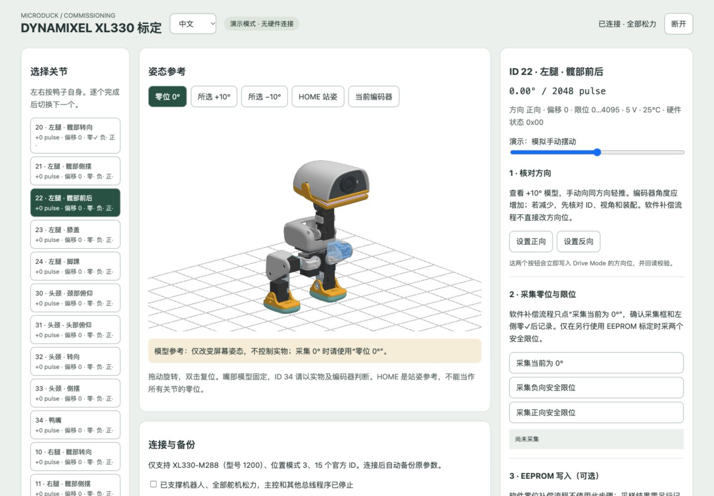
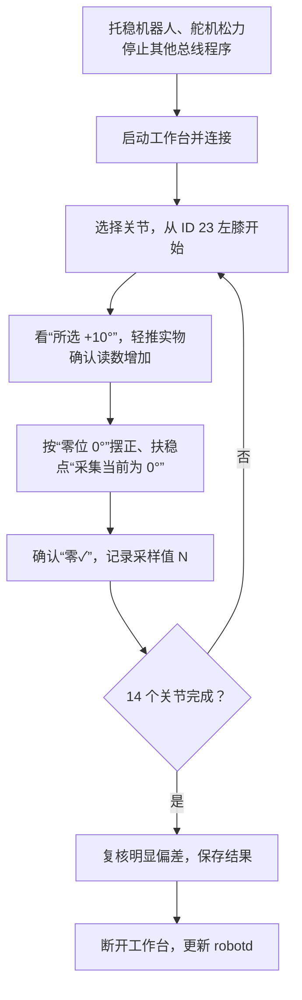

# microduck-tools

**简体中文** | [English](README.en.md)

Microduck 的 XL330 舵机零位标定工作台和配套的 V3 标定托盘。工作台运行在电脑上，默认通过 SSH 使用主控的舵机串口，也可以用 USB 串口适配器直连。

| 目录 | 内容 |
| --- | --- |
| `tools/xl330-calibration/` | 标定工作台：网页、后端、3D 渲染器、测试 |
| `assets/` | 3D 模型、照片、截图 |
| `CAD/` | V3 托盘 STEP / STL |
| `patches/` | robotd 软件零位补偿补丁 |
| `work/` | 本机生成的备份与采样记录，不提交 |

## 目录

- [实拍与工作台](#workbench)
- [安装与连接](#connection)
- [标定流程](#calibration-flow)
- [应用到 robotd](#apply-calibration)
- [附：EEPROM 写入](#eeprom)
- [供电与测试](#offline-tests)
- [托盘打印](#cad-printing)
- [来源与许可](#licenses)

<a id="workbench"></a>

## 实拍与工作台

机器人背部朝下放入托盘，头部、躯干和双脚分别由对应区域承托。照片背景经 AI 辅助虚化。


| 托盘俯视 | 机器人摆放俯视 |
| --- | --- |
|  |  |



- 支持 15 台 **XL330-M288-T（型号 1200）、位置模式 3**。
- 只写 EEPROM 中的 Drive Mode 方向位、Homing Offset、Min/Max Position Limit；不启用扭矩、不发送目标位置、不停止其他程序、不改 IMU。
- 连接时自动把原参数备份到 `work/xl330-calibration-backups/`。
- 3D 模型高亮所选舵机，被外壳挡住的部分半透明显示；拖动旋转，双击复位。
- 顶部可切换中文 / English；外部系统返回的诊断信息保留原文。

离线演示（无需硬件）：

```bash
./start-calibration.sh --demo
```

然后打开 <http://127.0.0.1:18092/>。

<a id="connection"></a>

## 安装与连接

在电脑的仓库根目录安装一次依赖（macOS / Linux）：

```bash
python3 -m venv .venv
.venv/bin/python -m pip install -r requirements.txt
```

两种连接方式选一种。波特率默认 **1000000**，真机默认启用 **Microduck 2S 配置（6.6–8.2 V）**，约 7.9–8.0 V 属于正常。

| 方式 | 路径 | 启动命令 |
| --- | --- | --- |
| **SSH（默认）** | 电脑 → SSH `microduck` → 主控 `/dev/ttyS2` → 舵机 | `./start-calibration.sh` |
| USB 直连 | 电脑 → USB 串口适配器 → 舵机 | `./start-calibration.sh --serial 电脑串口路径` |

<a id="ssh-connection"></a>

### SSH（默认）

主控上不部署网页，也不需要端口转发。连接期间，工作台通过 SSH 在主控内存中临时运行串口助手，断开后退出并释放串口。

1. 在电脑 `~/.ssh/config` 中配置别名（替换主机名和用户名），用密钥或 agent 免密登录，仓库不保存密码：

   ```sshconfig
   Host microduck
       HostName YOUR_ROBOT_HOST
       User microduck
   ```

   验证：`ssh -o BatchMode=yes microduck true` 应直接成功。也可用 `--ssh user@host` 指定其他目标。

2. 首次使用时登录主控（需 Python 3.9+），只安装串口依赖：

   ```bash
   python3 -m pip install --target "$HOME/.local/share/microduck-serial/deps" \
     dynamixel-sdk==4.0.5 pyserial==3.5
   ```

   默认也会搜索旧目录 `~/diagnostics/readlibs`。可用 `--remote-python` 指定解释器，用 `--remote-pythonpath`（可重复）替换依赖目录。

3. 在主控上确认没有其他程序占用总线，有就按正常流程停止：

   ```bash
   pgrep -af 'robotd|observer|server.py'
   fuser -v /dev/ttyS2
   ```

   权限不足时用有权限的账户检查，没有输出不代表串口空闲。

4. 在电脑运行 `./start-calibration.sh`，打开 <http://127.0.0.1:18092/>，勾选准备确认项，点 **检测并连接**。
5. 结束时先点网页 **断开**，再在终端按 `Ctrl+C`，最后按原流程恢复控制系统。

<a id="usb-connection"></a>

### USB 直连

需要兼容 DYNAMIXEL TTL 半双工总线的适配器；主控的普通 USB 口不提供舵机串口。

1. 断电接好总线和公共地，再恢复机器人原 2S 供电；适配器只用于通信，避免重复供电。停止主控对总线的访问。
2. 找到电脑上的串口（macOS 通常是 `/dev/cu.usbserial-…`，Linux 通常是 `/dev/ttyUSB0`），确认未被占用后启动：

   ```bash
   .venv/bin/python -m serial.tools.list_ports -v
   SERIAL_PORT=/dev/cu.usbserial-实际设备名
   lsof "$SERIAL_PORT"
   ./start-calibration.sh --serial "$SERIAL_PORT"
   ```

3. 浏览器操作和结束方式同 SSH。

<a id="connection-issues"></a>

### 连接问题

- **18092 端口被占用：** `lsof -nP -iTCP:18092 -sTCP:LISTEN`；若是旧的 SSH 网页转发，先退出旧隧道。
- **SSH 失败：** 先验证 `ssh -o BatchMode=yes microduck true`，再查主控串口权限、占用和依赖。
- **检测不通过：** 按页面提示处理型号、模式、扭矩、温度、总线或供电问题。
- **采集或校验提示错误**（如关节未静止、偏移超限）：会话保持连接，已采集的数据保留，处理后重试即可。
- **通信中断或写入失败：** 工作台断开且不重试写入。写入期间中断可能已部分写入，重连后先核对参数和故障前的备份。

<a id="calibration-flow"></a>

## 标定流程

本流程只采零位，用于 robotd 软件补偿：**不点“设置正向 / 反向”、不采限位、不点“写入”。** 方向和限位由机械装配决定，不能为了让读数接近 0 而修改。



### 1. 连接后核对基准

- 15 个舵机都在线且松力，备份已生成。
- “偏移”：膝关节 ID 13、23 为 **−512**，其余为 **0**。

托稳机器人；检查某个关节时托住相邻连杆，头颈检查时托住头。左右按机器人自身判断。**松力时随意摆放的读数不是误差，必须先按模型摆到零位再采。**

### 2. 每个关节的操作

1. 在左侧选关节，确认右侧标题和实时读数已切换。
2. 点 **“零位 0°”**，把实物摆成模型姿态。不要用“HOME 站姿”或“当前编码器”当零位参考。
3. 点 **“所选 +10°”**，向模型所示方向轻推实物，右侧角度应**增加**。如果减少或不变，停下来检查 ID、视角和装配，不要点方向按钮。
4. 回到“零位 0°”，摆正扶稳，点 **“采集当前为 0°”**。十次读数相差超过 8 pulse 会提示“未静止”，扶稳后重采即可。
5. 确认采集框出现 `零位：N pulse`、左侧出现 `零✓`。**记录采集框里的 N**，不要记松手后的实时读数。零偏 = N − 2048（1° ≈ 11.38 pulse）。

采集后右侧实时角度不会变成 0°，因为补偿要到 robotd 里才生效。

| 顺序 | ID / 关节 | 视角 | 对照重点 |
| --- | --- | --- | --- |
| 1 | 23 左膝 | 侧面 | 大腿与小腿伸直 |
| 2 | 20 左髋转向 | 顶视 | 脚尖朝正前方 |
| 3 | 21 左髋侧摆 | 正面 | 腿不外撇、不内收 |
| 4 | 22 左髋前后 | 侧面 | 大腿相对躯干的前后角度 |
| 5 | 24 左踝 | 侧面 | 脚底板相对小腿的角度 |
| 6–10 | 13、10、11、12、14 右腿 | 同左腿 | 可与左侧交叉对照 |
| 11 | 30 颈部俯仰 | 侧面 | 托住头，看脖子相对躯干的倾角 |
| 12 | 31 头部俯仰 | 侧面 | 头部低头 / 抬头角度 |
| 13 | 32 头部转向 | 顶视 | 嘴朝正前方 |
| 14 | 33 头部侧摆 | 正面 | 头部不歪 |

**ID 34 鸭嘴：** 模型中的嘴是固定的，没有零位参考。只轻轻合嘴、记录读数作备注，不采集，补偿保持 0。

### 3. 保存与复核

页面上的采集结果不会自动存盘，备份文件里也没有。全部采完、仍处于连接状态时，在电脑仓库根目录另开终端保存：

```bash
mkdir -p work/zero-surveys
curl --fail --silent --show-error http://127.0.0.1:18092/api/state \
  -o "work/zero-surveys/zero-survey-$(date +%Y%m%d-%H%M%S).json"
```

检查 14 个非嘴部关节的 `joints[].marks.zero` 都有值。**保存前不要断开或重连**，重连会清空采样。

偏差超过约 3°、或两次摆放不一致的关节，重新摆正后再采一次，并确认采集框已更新为新结果。手工摆放的重复误差约 ±1.5°，一两个 pulse 的差别不必追求。复核后再保存一次，然后断开工作台。

<a id="apply-calibration"></a>

## 应用到 robotd

适用于 Pollen Robotics `microduck` **daemon-v0.17.8**（提交 `942e58e3aa6dbb28e7037203fff11866122c7567`）。[补丁](patches/robotd-v0.17.8-gyro-zero-trim.patch) 把零位偏差编译进 `robotd`：

- `duck-control/src/model.rs`：`ZERO_TRIM_COUNTS` 数组，默认全 0。
- `duck-control/src/bus.rs`：读取位置时减去补偿，发送目标时加上补偿。
- `duck-control/src/imu.rs`：独立的 IMU v1.2 角速度单位修正（`count / 16.4` → °/s）；使用该协议的 IMU 需保留。

robotd 启动时会把 Homing Offset 校正为 ID 13、23 = −512、其余 = 0，所以要用软件补偿，不要依赖 EEPROM 写入。同一偏差不要同时留在 EEPROM 和数组里；把备份 JSON 复制到主控也不算应用。

### 1. 填写补偿

```text
ZERO_TRIM_COUNTS[关节] = 零位采样值 N − 2048
```

前提是 Homing Offset 处于上面的基准。如果改过偏移，最稳妥的做法是先恢复基准、再重新采样。

数组按 `JOINT_IDS` 顺序排列，**不是按 ID 从小到大**。下面的数值只是示例，不能直接用：

```rust
pub const ZERO_TRIM_COUNTS: [i32; NUM_JOINTS] = [
    -25, 16, 5, 3, 8,        // 左腿：20 21 22 23 24
    -3, -6, -3, -54, 0,      // 头颈、嘴：30 31 32 33 34
    -51, -40, -42, -22, -10, // 右腿：10 11 12 13 14
];
```

ID 34 保持 0，`DEFAULT_POSITION`（站姿）不改。把测试 `zero_trims_are_neutral_by_default` 改成核对你这台机器人的实测值。

### 2. 构建与部署

在电脑上取得固定基线并打补丁（不要覆盖已有目录，也不要重复打补丁）：

```bash
TOOLS_ROOT="$PWD"
git clone https://github.com/pollen-robotics/microduck.git ../microduck-runtime
cd ../microduck-runtime
git switch -c calibration-v0.17.8 942e58e3aa6dbb28e7037203fff11866122c7567
git apply --check "$TOOLS_ROOT/patches/robotd-v0.17.8-gyro-zero-trim.patch"
git apply "$TOOLS_ROOT/patches/robotd-v0.17.8-gyro-zero-trim.patch"
```

填好补偿后运行 `cargo test -p duck-control`，再按上游 [开发构建与部署说明](https://github.com/pollen-robotics/microduck/blob/942e58e3aa6dbb28e7037203fff11866122c7567/docs/robot/dev-push.md) 构建并安装，例如 `scripts/dev-push.sh microduck`。部署会重启相关服务，**部署前先断开工作台**。

### 3. 验证与回退

1. 确认 systemd 实际启动的是新二进制（`systemctl cat robotd`），日志正常，IMU ready。
2. 机器人不动的情况下，从无补偿版本切换后，反馈应变化 `−补偿 × 2π / 4096`。
3. 松力摆到机械零位时反馈接近 0；沿模型正方向推动时反馈增加。
4. 确认策略目标加上补偿后仍在 EEPROM 位置限位内。

回退时恢复上一组数组，重新构建并安装。

<a id="eeprom"></a>

## 附：EEPROM 写入（可选）

仅在明确采用 EEPROM 标定、且控制程序不会覆盖这些寄存器时使用。采完零位和正负两个限位后，点“计算寄存器变化”核对，再写入：

```text
新 Homing Offset = 旧 Homing Offset + 2048 − 零位采样值
```

- 偏移必须在 ±1024 内，否则需要重装舵盘；限位必须在 0–4095 内且包住 2048；不用取模掩盖跨圈。
- 方向按钮只改 Drive Mode 方向位，会立即写入并回读。
- 可以恢复所选关节到本次连接前的参数，或从历史备份恢复。**保留备份目录**，并确认备份来自同一台机器人。
- 写入或回读出错时工作台会断开，可能已部分写入；重连后用故障前的备份恢复，不要用重连时新生成的备份。

<a id="offline-tests"></a>

## 供电与测试

**2S 供电：** 真机默认使用 `--microduck-2s`，要求电压 6.6–8.2 V，允许并显示输入电压报警位 0x01。其他硬件错误、扭矩开启或温度 ≥ 60°C 时拒绝操作。不修改 Shutdown 或电压限值。依据：[Microduck 官方设计文档 §3.2](https://github.com/pollen-robotics/microduck/blob/main/docs/design/robotd-design.md#32-state-out)。

**离线测试**（模拟寄存器，不能代替真机验证）：

```bash
python3 -m unittest discover -s tools/xl330-calibration -p 'test_*.py' -v
node --test tools/xl330-calibration/test_i18n.cjs
```

<a id="cad-printing"></a>

## 托盘打印

| 零件 | STEP | STL | 数量 |
| --- | --- | --- | ---: |
| 上半件 | [head.step](CAD/head.step) | [head.stl](CAD/head.stl) | 1 |
| NP-F550 避空修正下半件 | [legs_npf550_r1.step](CAD/legs_npf550_r1.step) | [legs_npf550_r1.stl](CAD/legs_npf550_r1.stl) | 1 |
| 蝴蝶插键 | [key.step](CAD/key.step) | [key.stl](CAD/key.stl) | 2 |

单位 mm。平底朝下、100% 比例，0.4 mm 喷嘴、PETG，拓竹默认 0.20 mm Standard 工艺。已有上半件和插键时只需打印下半件。

用软魔术贴轻压定位，避开电池、卡扣和线束；动作测试前取出机器人。按标准 NP-F550 外形核验，不保证兼容 25–26 mm 加厚电池；0.4 mm 间隙需实物试装。托盘不能代替精密角度量具。

切片器预测值（Bambu Studio 02.08.02.61 CLI，P1S、Bambu PETG Basic，2026-10-27，未实机计时）：

| 打印盘 | 零件 | 耗材 | 含启动的预计时间 |
| --- | --- | ---: | ---: |
| 第一盘 | `head` ×1 ＋ `key` ×2 | 78.30 g | 2 小时 17 分 |
| 第二盘 | `legs_npf550_r1` ×1 | 46.20 g | 1 小时 44 分 |
| **整套** | **4 件** | **124.50 g** | **4 小时 1 分** |

建议备料：只打下半件 55 g，整套 140 g。

<a id="licenses"></a>

## 来源与许可

**本仓库自有软件代码采用 [Apache-2.0](LICENSE)**，包括 `tools/` 中的自有代码、启动脚本和测试。`patches/` 中针对 Apache-2.0 上游软件的改动按 Apache-2.0 提供，保留上游归属。该许可不覆盖机器人几何、CAD / STL / STEP、照片或第三方依赖。

| 内容 | 来源与适用说明 |
| --- | --- |
| 机器人参考几何、界面机器人模型及衍生夹具 | Pollen Robotics [`microduck_rl`](https://github.com/pollen-robotics/microduck_rl/tree/d424a0c899f6b33cbd3daeb279913134349c0b63)，提交 `d424a0c899f6b33cbd3daeb279913134349c0b63`。锁定版 README 标明模型为 CC BY-SA-NC，未写明版本号；不自行追加版本或商业授权。见[固定版本的上游 README](https://github.com/pollen-robotics/microduck_rl/blob/d424a0c899f6b33cbd3daeb279913134349c0b63/README.md#license)。软件的 Apache-2.0 条款不覆盖机械模型。 |
| XL330 标定工作台及 3D 渲染器 | 自有代码，采用 [Apache-2.0](LICENSE)。交互参考 [kissqy/Microduck-kissqy](https://github.com/kissqy/Microduck-kissqy)，DYNAMIXEL Protocol 2.0 后端为独立实现，未复制对方源码、标定数据或界面资产。寄存器依据 [XL330 官方控制表](https://emanual.robotis.com/docs/en/dxl/x/xl330-m288/)。 |
| 控制程序适配补丁 | 基于 Pollen Robotics [`microduck` 固定提交](https://github.com/pollen-robotics/microduck/tree/942e58e3aa6dbb28e7037203fff11866122c7567)，按 Apache-2.0 提供。补丁默认零补偿，需填写各自实测值。 |
| 实拍照片 | 用户提供的机器人与标定托盘照片，用于本项目说明；不自动套用代码或机械模型许可。 |
| 标定用 3D 打印夹具 | V3 零位托盘参考星猫的 XGO Duck 中位托盘（`R7_X2D04_PETG_slice_reference.gcode.3mf`，CC BY-NC-SA 4.0），仅借鉴仰卧定位方式。本设计和衍生几何按 CC BY-NC-SA 4.0 保留署名和非商业条件，不扩大上游模型授权范围。 |

本项目是非官方个人研究复刻，不代表 Pollen Robotics 官方发布。
