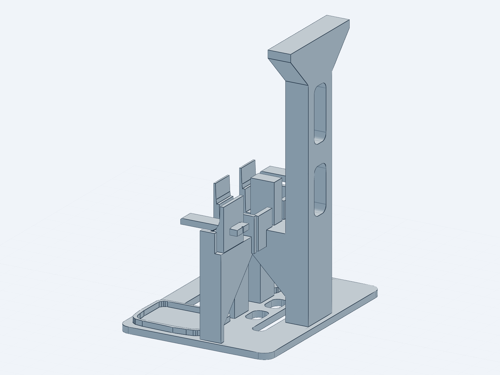
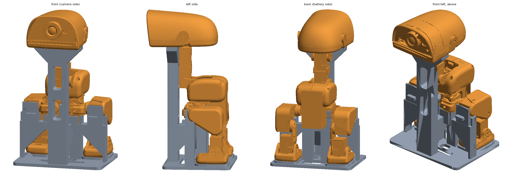

# 零位标定立架 r3（microduck + NP-F550）

立架摆在鸭子的**正前方**。用法：

1. 把鸭子摆成零位，从正上方竖直放下去，它会靠自重稳在架子上：
   - 头的底面压在柱顶平面上；
   - 两个髋部 yaw 连杆落在横台上，前、后、外侧、中间都有挡块；
   - 两条大腿落在横台两端的托面上，前面有钩子挡住；
   - 双脚踩进底座的定位边里。
2. 从前面把两根**髋俯仰插销**分别推进左右托架的槽里，推到插销前端的挡块碰到钩子为止。插销会伸到 12/22 号舵机（髋俯仰）的底面下面，从轴线前 9.5 mm 一直托到轴线后 23 mm。

鸭子身后不需要任何东西。零位时整机重心正好在脚尖上方，鸭子会自己往前靠在架子上。





| 文件 | 内容 |
| --- | --- |
| [`CAD/zero-stand/zero_stand_npf550_r3.step`](../../CAD/zero-stand/zero_stand_npf550_r3.step) | 立架 STEP |
| [`CAD/zero-stand/zero_stand_npf550_r3.stl`](../../CAD/zero-stand/zero_stand_npf550_r3.stl) | 立架打印用 STL |
| [`CAD/zero-stand/zero_stand_pins.step`](../../CAD/zero-stand/zero_stand_pins.step) / [`.stl`](../../CAD/zero-stand/zero_stand_pins.stl) | 髋俯仰插销，一组 3 根（间隙 0.1 / 0.2 / 0.3 mm），平放打印 |
| `zero_stand.py` | build123d 生成脚本，参数集中在文件开头（插销参数是 `PIN_*`） |
| `zero_stand_pin.py` | 插销的生成脚本 |
| `analyze_robot.py` | 把官方 MJCF 网格摆成零位姿态，电池换成标准 NP-F550，生成 `ref/drop.npz`、`ref/parts.npz`、`ref/floor_shift.npy`、`ref/robot_zero_npf550.stl`（后几个不提交） |
| `check_stand.py` | 检查鸭子能否竖直放入，并列出鸭子每个零件到架子的最近距离 |
| `joint_play.py` | 每个关节单独转动，量它转多少度会碰到架子（`--body-only` / `--depth N` 只转前几级零件） |
| `audit_features.py` | 列出每个部件的体积，以及它实际贴住鸭子的面积 |

## 定位面

立架上的间隙统一 0.6 mm（保证能竖直放进去）；插销是放好后再插的，间隙可以小得多。

| 部位 | 定位面 | 约束 |
| --- | --- | --- |
| 头 | 柱顶平面（38 × 80 mm），顶住头的底面 | 头的高低、俯仰、横滚 |
| 髋 yaw 连杆（10/20） | 横台托底面；前挡、后挡、外侧挡、两腿之间的中间块 | 连杆的位置和朝向 |
| 髋俯仰（12/22） | 插销顶面托住舵机底面（z = 79），从 x = 13.5 到 x = −19，跨过俯仰轴（x = 4） | 俯仰两个方向 |
| 大腿 | 托面沿大腿底面的斜坡走，到大腿前端（x = 16.2）外向上翻成钩子；外侧有耳挡 | 大腿 |
| 双脚 | 底座上每只脚一圈封闭的定位边 | 脚的位置和朝向 |

**为什么 12/22 要用插销。** 俯仰轴后面那半个舵机底面，正下方被脚整个挡住（脚的 y 范围 29–70，覆盖整个大腿宽度）。从上往下放的立架够不到那里，只能托到轴线前面 2–14 mm 那一窄条，几乎没有力臂。舵机底面和脚之间其实是空的（z 18–79），所以改成放好后从前面水平插进去。

**插销选哪根。** 3 根插销顶面到舵机底面的间隙分别是 0.1 / 0.2 / 0.3 mm，挡块前面刻的槽数就是间隙（一个槽代表 0.1 mm）。左右各用**能推进去的最紧的那根**，用来吸收打印误差。

**柱顶是平面，所以头的左右平移和水平转动（head_yaw）不受立架约束。** 标定 head_yaw 时，需要手动把头摆正。

**躯干和电池都不接触。** 双脚、髋部、大腿都卡住后，躯干的位置由关节链决定。

电池按标准 NP-F550（38.2 × 70.6 × 20.5 mm）建模，前面贴着电池支架。电池 5 mm 以内没有任何架子表面。

## 关节余量（`joint_play.py`，0.1 mm 插销）

| 关节 | ID | 余量 | 测法 |
| --- | --- | --- | --- |
| 髋俯仰 | 22 / 12 | 0.30–0.60° | 只转大腿 |
| 髋横滚，大腿外侧往下 | 21 / 11 | 0.15° | 髋连杆和大腿一起转 |
| 髋横滚，大腿外侧往上 | 21 / 11 | 立架本身不挡 | 靠脚：横滚轴沿 x，膝和踝补偿不了，外侧往上只能让脚掌一边翘起，鸭子自重压着脚掌。整条腿一起转时 0.05–0.1° 就碰到 |
| 其余腿部关节 | | 0.05–0.2° | 整条腿一起转（脚被定位边卡住） |

改用 0.6 mm 间隙的插销时，12/22 的余量是 1.7–4.6°。

## 部件组成

| 部件 | 作用 |
| --- | --- |
| 细柱 | 撑起头托 |
| 柱顶两侧 45° 斜撑 | 把平板撑出去，打印不用支撑 |
| 横台到细柱的 45° 斜梁 | 托住横台中段 |
| 髋后挡（落地） | 从底座直接立起来（两脚之间 \|y\| < 29 下方是空的），同时托住横台中段的后沿 |
| 两根腿 + 45° 斜撑 | 托住横台两端；斜撑往里伸到 \|y\| = 30，让横台下面的跨度不超过 14 mm（24 mm 时 Bambu Studio 会报 floating cantilever） |
| 托架上的插销槽 | 12.6 × 4.9 mm，穿过托架和钩子 |

## 校验（r3）

```bash
python tools/zero-stand/analyze_robot.py <官方 robot_walk.xml，同目录下需有 assets/*.stl>
python tools/zero-stand/check_stand.py CAD/zero-stand/zero_stand_npf550_r3.stl
python tools/zero-stand/joint_play.py --body-only <robot_walk.xml> <立架+插销 STL> left_hip_pitch right_hip_pitch
python tools/zero-stand/audit_features.py
```

- **竖直放入**：在架子表面取 24 320 个采样点，每个点都低于它正上方鸭子的最低点，放入过程中不会碰到。
- **插销**：和立架没有干涉；插入路径（x −19.6 … 32，\|y\| 46.4 … 61.6，z 73.8 … 78.4）里没有鸭子的任何零件。
- **贴合间隙**：髋部、大腿 0.53–0.73 mm；头 0.65–0.8 mm；插销 0.13 / 0.23 / 0.33 mm。
- **电池**：5 mm 以内没有任何架子表面。

模型来源是 Pollen microduck 仿真资产里的 `robot_walk.xml` 和 `assets/*.stl`。本仓库 `assets/models/robot_walk.xml` 是不带网格的运动学版本，不能用来生成立架。

## 打印

切片环境：Bambu Studio 02.08.02.61 命令行，P1S 0.4 mm 喷嘴，0.20mm Standard，Bambu PETG Basic，关闭支撑，2026-11-01。下面都是切片器的预测值，没有实际计时。

| | 尺寸 | 体积 | 预计用时 | 耗材 |
| --- | --- | --- | --- | --- |
| 立架（底座朝下，直立） | 118 × 154 × 209 mm | 351 cm³ | 4 小时 42 分 | 55.0 m，约 168 g |
| 插销一组 3 根（平放） | 46 × 56 × 4.5 mm | 7.5 cm³ | 11 分 | 1.8 m，约 6 g |

插销要打**两组**（左右各一组）。两个文件切片都没有报悬空或悬臂警告，立架的 G-code 也通过了 gcode 工具的校验。克数按 1.75 mm 线径、PETG 密度 1.27 g/cm³ 计算。

## 和参考件的区别

1. **鸭子姿态不同。** 参考照片里的鸭子脖子前倾、躯干后仰，而官方 XL330 版零位时脖子是竖直的，照片里应该是别的复刻版本。所以所有定位面都按 microduck 的零位来做。
2. **柱顶两端的上翘耳朵没有做。** 从照片看不出它们卡的是头的哪个部位。

## 还没验证的

- 没有实物试装，0.6 mm 间隙和插销的松紧都要实物确认；
- 插销悬出托架 23.5 mm，PETG 打印件在舵机重量下的变形没有算；
- 鸭子靠自重停在架子上，往后推是推得动的，采样时不要碰它；
- 头部左右平移和 head_yaw 不受约束；嘴（ID 34）不受约束。
